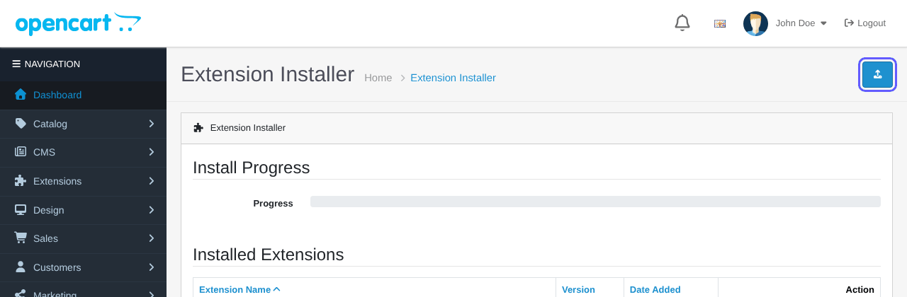
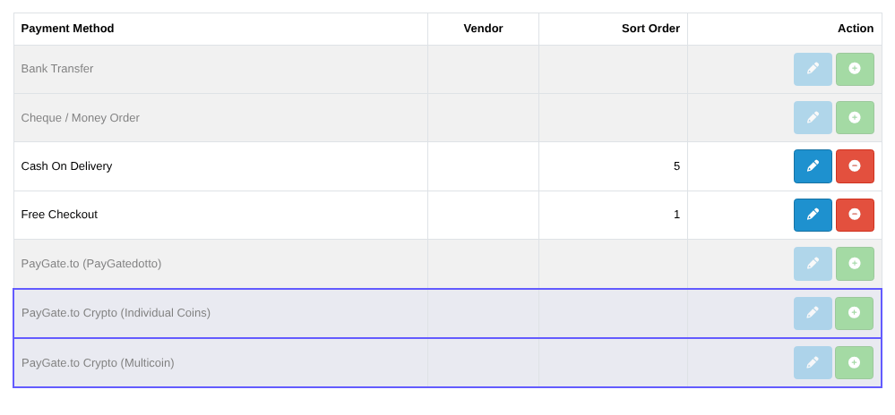
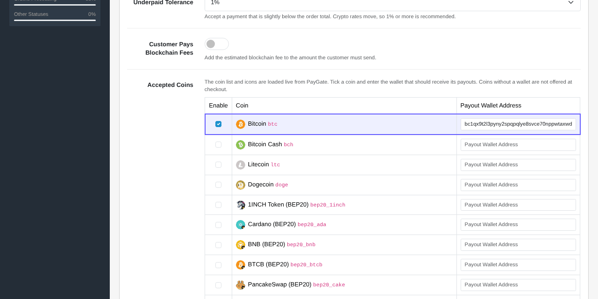
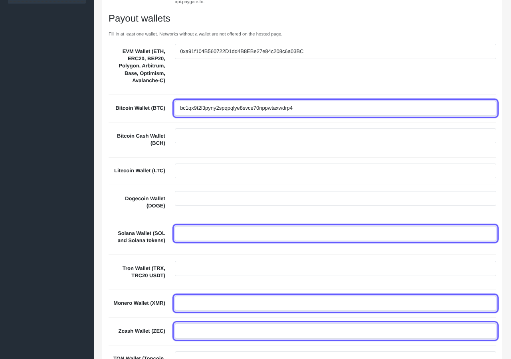
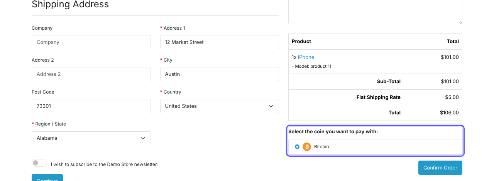
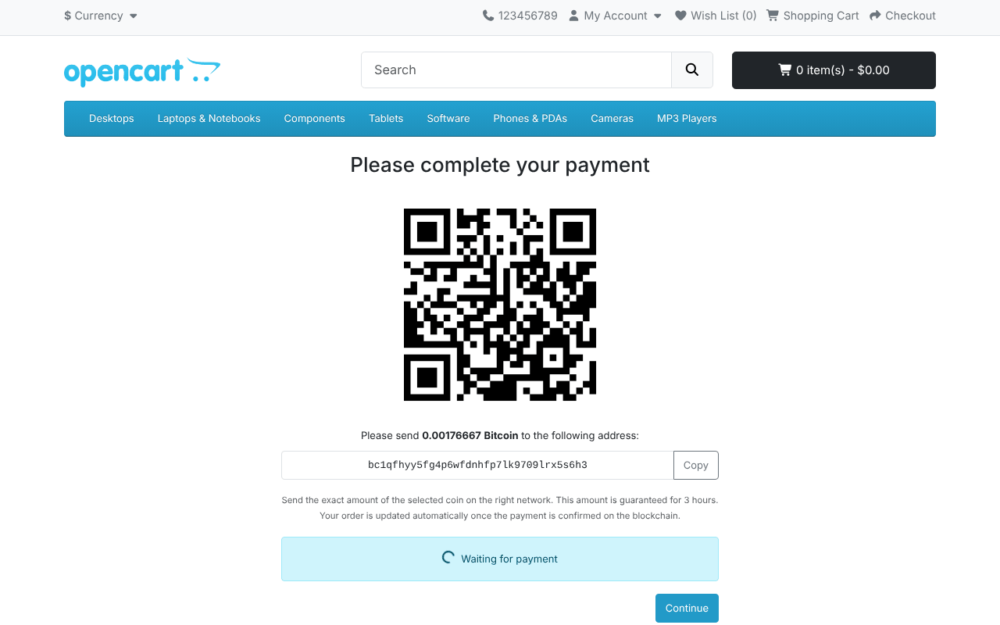
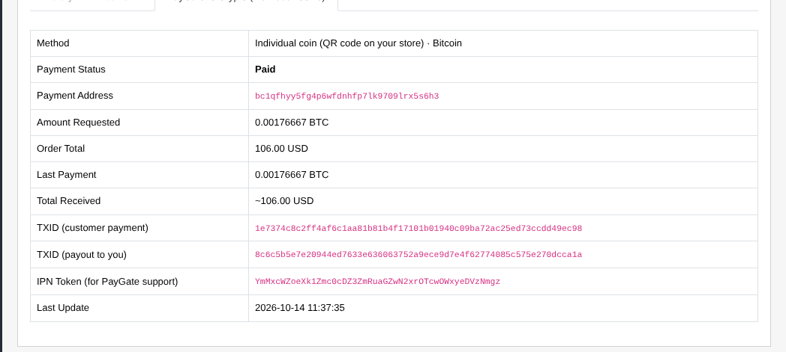

# opencart-crypto-payment-gateway
OpenCart Crypto Payment Gateway Instant Payouts. No KYC crypto payment gateway extension for OpenCart, self hosted on your OpenCart store.

> **The only crypto payment gateway with instant payouts for Solana (SOL), Monero (XMR), Zcash (ZEC) and Bitcoin (BTC).**
> Every payment is forwarded straight to your own wallet the moment it is confirmed: no holds, no sign up, no KYC. The same support is built into all our plugins and modules: WooCommerce, WHMCS, OpenCart, PrestaShop and Magento.

## Features

- Accept **Bitcoin, Solana, Monero, Zcash, ETH, USDT, USDC** and hundreds of other coins and tokens on BTC, BCH, LTC, DOGE, ETH, ERC20, BEP20, Polygon, Arbitrum, Base, Optimism, Avalanche-C, Solana, Tron (TRC20), TON and more ([full list and minimums](https://paygate.to/crypto-payment-gateway-no-kyc-instant-payouts/#minimumorder)).
- **Instant payouts**: crypto is forwarded to your wallet the moment the payment is confirmed, with no delay or holds.
- **No KYC and no registration**: you and your customers stay anonymous.
- **QR code on your own site** with a unique address for every order, or one **Multicoin** option where the customer picks any coin on the hosted page.
- Payment confirmations signed by PayGate.to and verified by the module: orders are marked paid by themselves.
- Choose who pays the blockchain fee: you or the customer.
- If a customer sends the wrong token or uses the wrong network, supported tokens are still forwarded to you automatically.
- Works with your own checkout domain and a free dedicated API endpoint ([custom domain guide](https://paygate.to/white-label-api-custom-domain-guide/)).
- Fees: **1.5% flat rate + blockchain fees**.
- If the customer sends less than the order total, the rest can be sent to the same address and both payments are added up.

📘 **Step-by-step guide with screenshots:** [https://paygate.to/crypto-payment-gateway-no-kyc-instant-payouts/opencart/](https://paygate.to/crypto-payment-gateway-no-kyc-instant-payouts/opencart/)

## Requirements

- **OpenCart 4.0.2.0 or newer**
- A public store with outbound HTTPS (the coin list is loaded live) and PHP OpenSSL
- A wallet address for each coin you want to accept

## Installation

1. **Prepare your wallets.** Crypto is forwarded to **your own wallet addresses**, one per coin or network: a Bitcoin address for BTC, a Solana address for SOL and Solana tokens, Monero and Zcash addresses for XMR and ZEC, and one `0x` address for ETH and all EVM networks (ERC20, BEP20, Polygon, Arbitrum, Base, Optimism, Avalanche-C). Use **self-custodial wallets** you control and **never exchange deposit addresses**.
2. **Download** [paygatedottocrypto.ocmod.zip](https://github.com/paygate-to/opencart-crypto-payment-gateway/raw/refs/heads/main/paygatedottocrypto.ocmod.zip) (keep the exact file name).
3. **Extensions › Installer**: click **Upload**, select the file, then click **+ Install**.

   

4. **Extensions › Extensions › Payments**: install **PayGate.to Crypto (Individual Coins)** and/or **PayGate.to Crypto (Multicoin)**, then click the pencil.

   

5. **Individual Coins**: in **Accepted Coins**, tick each coin and paste its payout wallet. Check the three order statuses (Pending / Processing / Failed), turn **Status** on and **Save**.

   

6. **Multicoin (optional)**: fill in the payout wallets, including **Solana Wallet (SOL and Solana tokens)**, **Monero Wallet (XMR)**, **Zcash Wallet (ZEC)** and **Bitcoin Wallet (BTC)**. Turn **Status** on and **Save**.

   

7. **Test**: the customer picks a coin and is taken to the payment page on your own store: QR code, amount, address with a Copy button and a live status. The amount is guaranteed for 3 hours.

   

   

8. When the payment is confirmed the crypto is forwarded to your wallet and the order moves to your paid status. The admin order page has a **PayGate.to Crypto (Individual Coins)** or **(Multicoin)** tab with every detail.

   

## Settings

| Setting | Description | Default |
|---|---|---|
| Accepted Coins (Individual) | Tick a coin and enter its payout wallet. | none |
| Payout wallets (Multicoin) | EVM, BTC, BCH, LTC, DOGE, SOL, TRX/TRC20, XMR, ZEC, TON. | empty |
| API Domain | Your dedicated API endpoint. | empty (uses api.paygate.to) |
| Custom Domain (Multicoin) | Domain of the hosted checkout page. | checkout.paygate.to |
| Underpaid Tolerance | Accept payments slightly below the total (0–10%). | 1% |
| Customer Pays Blockchain Fees | Add the estimated network fee. | off |
| Order Status (awaiting / paid / underpaid) | Statuses for each stage. | Pending / Processing / Failed |
| Logo URL, colours (Multicoin) | Branding of the hosted page. | empty |

Payment confirmations are signed by PayGate.to and verified by the extension, work with SEO URLs and still reach the store in maintenance mode.

Full product page: [https://paygate.to/crypto-payment-gateway-no-kyc-instant-payouts/](https://paygate.to/crypto-payment-gateway-no-kyc-instant-payouts/) · Support: [Telegram](https://t.me/PayGate_to)
